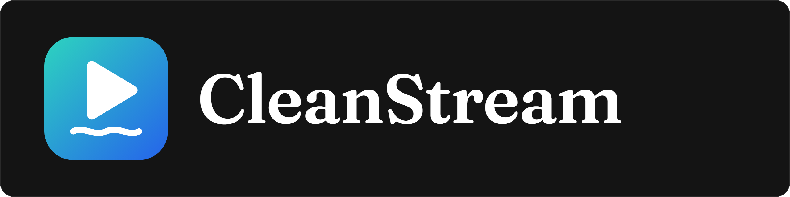

Playback for Jellyfin. It's meant to start fast, play the original file when the connection allows it, and change
quality smoothly when it doesn't.

**Status:** In development. Nothing to install yet.

## Part of Campground

CleanStream is one of the [Campground](https://github.com/AHouseOfBards/Campground-Jellyfin) plugins for Jellyfin.
When it's ready, it will be offered there.

## License

MIT. See [LICENSE](LICENSE).
